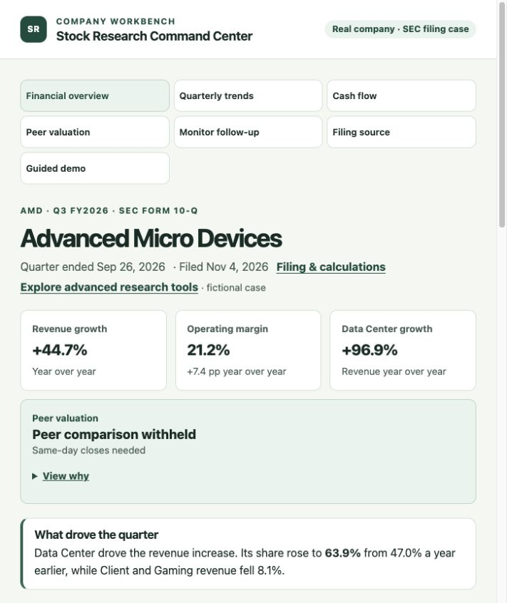

# Stock Research Command Center

An evidence-first equity research workbench built with Python and Streamlit. Review what drove a company's results, trace findings to SEC filings, and keep open questions with the evidence behind them.

## Try the Public Demo

| Start here | What you can explore |
| --- | --- |
| [Interactive English demo](https://yuzej21.github.io/Stock-Analysis/) | A static, offline-capable fictional company case from search through five company sections and Monitor. |
| [Real AMD filing case](https://yuzej21.github.io/Stock-Analysis/amd.html) | A separate, dated Q3 FY2026 SEC filing walkthrough with quarterly drivers, operating margin, cash flow, and an open research question. [English screenshot](docs/assets/amd-sec-filing-case.jpg). |


*The screenshot shows the fictional public demo. The full research workspace runs locally.*

<details>
<summary>Real company example: AMD SEC filing case</summary>

[Open the real AMD case](https://yuzej21.github.io/Stock-Analysis/amd.html) · [Download the English screenshot](docs/assets/amd-sec-filing-case.jpg)



*Quarter ended September 26, 2026; filed November 4, 2026. This is a dated filing case, with public peer valuation withheld pending approved same-day price evidence. Its advanced-tool links open the separately labelled fictional workflow.*

</details>

### Two-minute walkthrough

Follow **Company Search → Overview → Financial Trends → Valuation & Peers → Research Notes → Data Sources → Monitor**.

1. Search for **FICT** or **Fogline Photonics**. Open the company and review **Overview** for business results, the dated close, and the peer result or gap.
2. In **Financial Trends**, compare reported annual and quarterly performance, inspect the chart and table evidence, and open **Business Trend**.
3. In **Valuation & Peers**, switch between three and two eligible peers, inspect exclusions, and try a discount-rate assumption in **Scenario Lab**. **Valuation methods** and **Peer Read-Through** retain their own evidence context.
4. In **Research Notes**, explore **Forward View**, **Catalysts**, **Research Decision Lab**, and the **Research brief**, then add a follow-up to Monitor.
5. Open **Data Sources** for periods, units, synthetic provenance, and missing observations.
6. In **Monitor**, select **Review saved evidence**, compare the two fixed fictional observations, and record **Reviewed** or **Still open** with a reason.

The fictional note, scenario control, and review decision reset on reload. The page fetches no live data. The separate AMD case uses the filing dated November 4, 2026; its public peer comparison remains withheld pending approved same-day price evidence. Its links to advanced tools open the fictional workflow. [Public walkthrough](docs/PUBLIC_DEMO_WALKTHROUGH.md) · [LinkedIn Featured copy](docs/LINKEDIN_PROJECT_BRIEF.md)

## Research Workflow

The full local workspace follows **Research Desk → Discover → Company Workbench → Monitor**.

| Destination | Research task |
| --- | --- |
| **Research Desk** | Search for a company online, resume saved SEC research, or open Monitor. |
| **Discover** | Switch between online company search and saved companies. Optional **Coverage studies → Self-service** inspects twelve declared companies and keeps failures and exclusions visible. |
| **Company Workbench** | Review one company through five connected sections, with financial, price, and source context. |
| **Monitor** | Revisit saved questions and evidence changes: User-authored follow-ups for notes, saved SEC comparisons, and the Follow-up Queue for legacy process items. Return to the company or exact pair. |

Company search accepts a name or ticker, including companies absent from local CSVs. Press **Research company** to collect online SEC financials, check the latest annual and quarterly filings, load dated prices and attempt the existing peer comparison. The company rail keeps five sections beside a focused analysis area, with a stacked layout on phones. Separate refresh options remain available; changing sections reuses loaded observations without new requests. **No coding session or prepared company CSVs are required for the supported online workflow.**

The optional self-service study uses **Inspect next company**, **Recheck company** and **Restart study**. It reports ten separate capabilities for a fixed semiconductor, bank, utility and foreign-issuer sample; navigation makes no source requests. Its replay check uses disposable private storage and writes no user notes or evidence. [Sample, measured results and boundaries](docs/CROSS_INDUSTRY_SELF_SERVICE.md)

## What You Can Do

| Company section | Included tools |
| --- | --- |
| **Overview** | One company heading, dated price and financial context, independently qualified annual diluted EPS, a peer valuation result or gap, and a compact financial chart and table. |
| **Financial Trends** | Annual/direct-quarter history, metric charts, period tables and online Business Trend: compatible revenue growth, operating margins and descriptive cash generation. Annual earnings components retain exact filing definitions and individual gaps. Cumulative cash flow stays separate. |
| **Valuation & Peers** | Source-bound annual diluted P/E with accepted/excluded industry references, observed peer read-through, and online Scenario Lab using reported annual revenue plus explicit growth, FCFF-margin and discount-rate assumptions. Missing capital structure leaves enterprise value only. Separately qualified saved Scenario Lab and sensitivities, Peer Read-Through, Valuation Methods and Historical Valuation Regime remain available. |
| **Research Notes** | Author an issuer-scoped append-only thesis journal, evidence, catalysts and outcomes, then use Forward View and Research Decision Lab to identify the next research action. Save/replay online research, compare changes and reopen it from Monitor. Notes require exact preview and explicit confirmation. Saved-model tools, outcome history and the offline HTML Research Brief remain separately qualified. No prepared financial CSV is needed. |
| **Data Sources** | Filing links, concepts, units, periods, publication and observation dates, source-rights context, and Data Health or Proof History when deeper verification is needed. |

Saved tools remain scoped to their selected company and research profile. Online observations do not automatically qualify a saved model, and section changes preserve editable scenario and research-record fields without carrying save confirmation forward.

### Online notes, evidence and Monitor

Search in Discover, open the company, then use **Research Notes**. Notes do not require a saved valuation report or local company price rows. Private user records are created only after preview and confirmation; they can be reopened from Monitor after a browser reload. Existing saved-workspace journals remain separate from CIK-scoped online notes.

Use **Saved SEC evidence** to save eligible annual observations, replay them and compare two saved inputs. Identical facts retain **No change**; different identities, periods, definitions or permissions retain gaps. Monitor lists saved SEC review items and user-authored follow-ups separately. A saved note identifies its research scope; it does not establish a current listing or financial coverage.

**Saved online research** retains trends, filing versions, peer exclusions, scenario assumptions and notes. Monitor reopens the exact historical snapshot and compares financial changes, source metadata and user edits separately. Research can inspect the exact 10-Q, an eligible native-currency IFRS 20-F, or consolidated results from a supported SEC 6-K. Native quarter and year-to-date observations retain separate dates, field definitions and source links. Overview leads with reported results, a comparable change when supported, peer valuation and research gaps. [Native quarterly evidence](docs/NATIVE_QUARTER_RELEASE.md) · [Native annual evidence](docs/NATIVE_ANNUAL_OVERVIEW_RELEASE.md) · [Exact 10-Q evidence](docs/EXACT_QUARTERLY_EVIDENCE_RELEASE.md)

The application retrieves data online while running locally. GitHub Pages hosts the demonstrations, not the full Streamlit workspace. [Online research workflow](docs/ONLINE_COMPANY_RESEARCH.md) · [Workflow release evidence](docs/ONLINE_COMPANY_WORKFLOW_RELEASE.md)

### MRVL earnings quality and peer fit

MRVL's **Valuation & Peers** section explains the reported annual denominator, business-sale gains, cash versus net income, compensation and amortization using online SEC evidence. A named Broadcom comparison shows the business rationale, different business mix and the annual-period exclusion. The issuer's exact annual GAAP-to-non-GAAP after-tax reconciliation is available for inspection, with signed adjustments, tax effects, source precision and separate share/EPS checks. Fields, dates, sources and missing reasons expand on demand. Gain-only tax allocation, normalized earnings and another valuation denominator remain unqualified. [Method and scope](docs/ONLINE_PEER_VALUATION.md#mrvl-annual-earnings-quality-and-named-avgo-context)

### Saved SEC evidence review

For **NEM, AMD, and DUK**, reopen an exact ordered pair from Monitor after two qualified annual SEC observations have been saved in the selected local profile. Real receipts stay private under ignored `outputs/local/`. Capture or import your own qualified observations when starting from a fresh clone.

- Compare supported fields and source-review metadata.
- Identical supported facts and source-review inputs show **Unchanged**. Source-review metadata changes are labelled separately. Incompatible identities, periods, units, or concepts retain their specific gaps.
- Record **Reviewed** or **Still open** with a required reason scoped to the company, pair, and research profile.
- A newer capture has its own review status. Existing receipts remain immutable, and a review decision leaves unresolved financial gaps visible.

The portable scope covers direct annual US-GAAP/USD revenue, operating income, operating cash flow, and capital expenditures when qualified. A changed source checksum or issuer-directory record is identified separately from a financial revision. [Saved SEC review method](docs/SEC_RESEARCH_REVIEWS.md)

## Run Locally

Use Python 3.10 or later and run these commands from the repository root.

```bash
python -m pip install -e '.[research]'
export SEC_USER_AGENT="Your Name your.email@example.com"
make dashboard
```

Open [http://localhost:8501/](http://localhost:8501/) for the Personal Research workspace. Use an identifying SEC user agent for online retrieval. Financial and price refreshes require network access.

After starting the app, use its browser interface directly; no ongoing coding session is needed. If `SEC_USER_AGENT` is not set, **SEC access** in company search accepts session-only request identification. The public Pages links above remain static demonstrations, not a hosted self-service research server. Unsupported custom/non-XBRL definitions, tax reconciliations, consensus and current share-class capital structure retain visible gaps. [Self-service method and boundaries](docs/SELF_SERVICE_COMPANY_RESEARCH.md) · [Bank peer evidence](docs/BANK_PEER_EVIDENCE_RELEASE.md) · [Bank snapshots](docs/BANK_RESEARCH_SNAPSHOT_RELEASE.md)

The repository's saved data, ignored local research files, and synthetic demo profile have separate contexts. Check the selected profile before comparing observations. [Data Profiles](docs/DATA_PROFILES.md) · [Online Company Research](docs/ONLINE_COMPANY_RESEARCH.md)

<details>
<summary>Controlled local demo and engineering checks</summary>

The separate controlled Public workspace follows Home → Stock Selector → Single-Stock Report → Data Health → Proof History.

```bash
make demo                  # print the local visitor walkthrough
make demo-dashboard        # start the bundled demo profile
# Open http://localhost:8501/?mode=public

python -m pip install -e '.[dev]'
make test                  # run the automated suite
make dashboard-smoke       # check dashboard startup
```

Data Health and Proof History remain available as Advanced Evidence. Operator mode contains maintenance and legacy compatibility tools. [Personal Research Mode](docs/PERSONAL_RESEARCH_MODE.md) · [Local Workflow Guide](docs/OPERATOR_GUIDE.md)

</details>

## Coverage and Evidence

- **Coverage is measured by capability.** Listing identity, issuer domicile, security type, active status, financial availability, analysis eligibility, and point-in-time coverage are distinct. Discover keeps unsupported and unverified records visible.
- **Peer comparisons have explicit gates.** The online annual P/E path requires compatible reported diluted EPS, verified issuer and security identity, same-day closing prices, and at least three qualifying industry references. Selection rationale and exclusions remain inspectable. [Peer valuation method](docs/ONLINE_PEER_VALUATION.md)
- **Each observation keeps its dates.** Annual, quarterly, and cumulative periods retain their definitions. Saved observations describe the evidence captured at that time.
- **Source rights apply independently.** SEC fact retention, archive inspection, and price-provider permissions have separate scopes. The current price path is for personal research, with commercial operation and redistribution held for separate review. [Data Strategy](docs/DATA_STRATEGY.md)
- **Evidence gaps remain visible.** Missing fields and unsupported comparisons stay withheld. A screenshot demonstrates the interface. Current readiness and source permissions require their own checks.

The supported workflow is research-only. Investment advice, broker account actions, order routing, trading automation, and direct buy or sell instructions are outside its scope.

## Project Status and Roadmap

| Stage | Current focus |
| --- | --- |
| **Available today** | A local research beta with online filing checks, trends, hypothetical scenarios, issuer notes, private snapshot/Monitor replay and a fixed twelve-company capability study with complete bank peer-source retention and historical snapshot replay. Existing saved tools, bounded MRVL review, English public demo, dated AMD filing case and annual review for NEM, AMD, and DUK remain available. |
| **Next** | Inspect exact filed facts for current quarters, extend qualified identity and native-currency support, and verify meaningful subsequent-filing changes. Preserve price, identity, period, definition, size and rights requirements. |
| **Later gates** | Hosted full-workspace operation, authentication and private workspaces, operated data rights, provider reliability, independent user evidence, and commercial validation. |

The [Roadmap](ROADMAP.md) is the active priority list. [Completed Milestones](docs/COMPLETED_MILESTONES.md) records shipped work and the evidence required to revisit parked features. Use `make next-stage` for the current local decision ladder.

For current selected-profile readiness, use `make readiness-ops-center`. A saved `make status-check TOP_N=5` snapshot can be stale.

## Documentation

| Topic | Guide |
| --- | --- |
| Public demo and sharing | [Public walkthrough](docs/PUBLIC_DEMO_WALKTHROUGH.md) · [LinkedIn project brief](docs/LINKEDIN_PROJECT_BRIEF.md) |
| Local research workflow | [Personal Research Mode](docs/PERSONAL_RESEARCH_MODE.md) · [Data Profiles](docs/DATA_PROFILES.md) |
| Financials and valuation | [Online Company Research](docs/ONLINE_COMPANY_RESEARCH.md) · [Online Peer Valuation](docs/ONLINE_PEER_VALUATION.md) |
| Evidence and calculations | [Saved SEC Reviews](docs/SEC_RESEARCH_REVIEWS.md) · [Research Methodology](docs/METHODOLOGY.md) · [Analysis Capability Audit](docs/analysis_capability_audit.md) |
| Coverage and sources | [Self-service capability study](docs/CROSS_INDUSTRY_SELF_SERVICE.md) · [Online Coverage Method](docs/ONLINE_RESEARCH_COVERAGE.md) · [Data Strategy](docs/DATA_STRATEGY.md) |
| Setup, maintenance, and release | [Local Workflow Guide](docs/OPERATOR_GUIDE.md) · [Hosted Demo Deployment](docs/HOSTED_DEMO_DEPLOYMENT.md) · [Public Release Checklist](docs/PUBLIC_RELEASE_CHECKLIST.md) |

<details>
<summary>Advanced and historical research tools</summary>

The local workspace retains Data Health, Proof History, Source Freshness Timeline, saved snapshots, Research Comparison View, Research Outcome Review, and the deeper research tools described in the guides. Their data, identity, and readiness requirements apply independently. Legacy picks, momentum rankings, portfolio views, and historical outputs remain Operator-only compatibility utilities.

The Earnings Nowcast pilot uses synthetic fixtures and has separate source, point-in-time, and calibration gates. [Pilot walkthrough](docs/EARNINGS_NOWCAST_PILOT.md) · [Operator guide](docs/OPERATOR_GUIDE.md)

</details>

## License

The root [LICENSE](LICENSE) governs this controlled portfolio-demo release. Visitors may inspect the code, documentation, and product design for evaluation. Copying, redistribution, sublicensing, hosting, and modified publication require written permission. [License Decision Guide](docs/LICENSE_DECISION_GUIDE.md)
