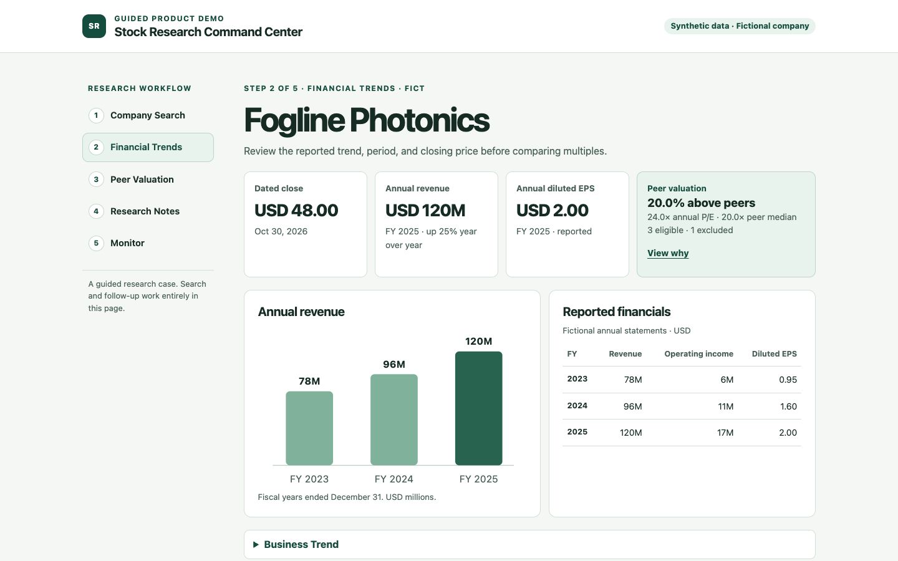

# Stock Research Command Center

An evidence-first equity research workbench built with Python and Streamlit. Review what drove a company's results, trace findings to SEC filings, and keep open questions with the evidence behind them.

## Try the Public Demo

| Start here | What you can explore |
| --- | --- |
| [Interactive English demo](https://yuzej21.github.io/Stock-Analysis/) | A fictional company from search through financial trends, peer valuation, research notes, and Monitor. |
| [Real AMD filing case](https://yuzej21.github.io/Stock-Analysis/amd.html) | A dated SEC filing walkthrough with quarterly drivers, operating margin, cash flow, and an open research question. |



*The screenshot shows the fictional public demo. The full research workspace runs locally.*

### Two-minute walkthrough

1. Search for **FICT** and open **Financial Trends**. Inspect the reported periods and **Business Trend**.
2. Open **Peer Valuation**. Switch between three and two eligible peers, inspect exclusions, and try a discount-rate assumption in **Scenario Lab**.
3. Use **Research Notes** to explore **Forward View**, **Catalysts**, and **Research Decision Lab**.
4. In **Monitor**, select **Review saved evidence**, compare the two fixed fictional observations, and record **Reviewed** or **Still open** with a reason.

The fictional note and review decision reset on reload. The separate AMD page uses a dated real filing and links into the fictional workflow. [Public walkthrough](docs/PUBLIC_DEMO_WALKTHROUGH.md) · [LinkedIn Featured copy](docs/LINKEDIN_PROJECT_BRIEF.md)

## Research Workflow

The full local workspace follows **Research Desk → Discover → Company Workbench → Monitor**.

| Destination | Research task |
| --- | --- |
| **Research Desk** | Resume saved work and see which follow-ups or evidence checks need attention. |
| **Discover** | Search SEC company identities online or browse saved companies. Inspect dated coverage and unresolved identity gaps. |
| **Company Workbench** | Review one company through five connected sections, with financial, price, and source context. |
| **Monitor** | Use the Follow-up Queue to revisit saved questions and evidence changes, then return to the company or its exact saved comparison. |

Company search accepts a name or ticker, including companies absent from local CSVs. Refresh financials and prices explicitly. Source and observation dates stay visible across the company review.

## What You Can Do

| Company section | Included tools |
| --- | --- |
| **Overview** | Dated price context, reported financial changes, and a peer valuation result or its missing-evidence explanation. |
| **Financial Trends** | Annual and directly reported quarterly history, growth, margins, cash generation, and separately qualified saved Business Trend. Cumulative cash-flow periods are labelled separately. |
| **Valuation & Peers** | Source-bound annual diluted P/E with eligible and excluded industry references, plus separately qualified saved Peer Read-Through, valuation scenarios, and sensitivities. |
| **Research Notes** | For a qualified saved company/profile, research questions, Forward View, Catalysts, Research Decision Lab, an append-only thesis journal, and an offline HTML research brief. Saved authoring uses an exact preview and explicit confirmation. |
| **Data Sources** | Filing links, concepts, units, periods, publication and observation dates, source-rights context, and Data Health or Proof History when deeper verification is needed. |

### Saved SEC evidence review

For **NEM, AMD, and DUK**, reopen an exact ordered pair from Monitor after two qualified annual SEC observations have been saved in the selected local profile. Real receipts stay private under ignored `outputs/local/`. Capture or import your own qualified observations when starting from a fresh clone.

- Compare supported fields and source-review metadata.
- Identical supported facts and source-review inputs show **Unchanged**. Source-review metadata changes are labelled separately. Incompatible identities, periods, units, or concepts retain their specific gaps.
- Record **Reviewed** or **Still open** with a required reason scoped to the company, pair, and research profile.
- A newer capture has its own review status. Existing receipts remain immutable, and a review decision leaves unresolved financial gaps visible.

The portable scope covers direct annual US-GAAP/USD revenue, operating income, operating cash flow, and capital expenditures when qualified. A changed source checksum or issuer-directory record is identified separately from a financial revision. [Saved SEC review method](docs/SEC_RESEARCH_REVIEWS.md)

## Run Locally

Use Python 3.10 or later and run these commands from the repository root.

```bash
python -m pip install -e '.[research]'
export SEC_USER_AGENT="Your Name your.email@example.com"
make dashboard
```

Open [http://localhost:8501/](http://localhost:8501/) for the Personal Research workspace. Use an identifying SEC user agent for online retrieval. Financial and price refreshes require network access.

The repository's saved data, ignored local research files, and synthetic demo profile have separate contexts. Check the selected profile before comparing observations. [Data Profiles](docs/DATA_PROFILES.md) · [Online Company Research](docs/ONLINE_COMPANY_RESEARCH.md)

<details>
<summary>Controlled local demo and engineering checks</summary>

The separate controlled Public workspace follows Home → Stock Selector → Single-Stock Report → Data Health → Proof History.

```bash
make demo                  # print the local visitor walkthrough
make demo-dashboard        # start the bundled demo profile
# Open http://localhost:8501/?mode=public

python -m pip install -e '.[dev]'
make test                  # run the automated suite
make dashboard-smoke       # check dashboard startup
```

Data Health and Proof History remain available as Advanced Evidence. Operator mode contains maintenance and legacy compatibility tools. [Personal Research Mode](docs/PERSONAL_RESEARCH_MODE.md) · [Local Workflow Guide](docs/OPERATOR_GUIDE.md)

</details>

## Coverage and Evidence

- **Coverage is measured by capability.** Listing identity, issuer domicile, security type, active status, financial availability, analysis eligibility, and point-in-time coverage are distinct. Discover keeps unsupported and unverified records visible.
- **Peer comparisons have explicit gates.** The online annual P/E path requires compatible reported diluted EPS, verified issuer and security identity, same-day closing prices, and at least three qualifying industry references. Selection rationale and exclusions remain inspectable. [Peer valuation method](docs/ONLINE_PEER_VALUATION.md)
- **Each observation keeps its dates.** Annual, quarterly, and cumulative periods retain their definitions. Saved observations describe the evidence captured at that time.
- **Source rights apply independently.** SEC fact retention, archive inspection, and price-provider permissions have separate scopes. The current price path is for personal research, with commercial operation and redistribution held for separate review. [Data Strategy](docs/DATA_STRATEGY.md)
- **Evidence gaps remain visible.** Missing fields and unsupported comparisons stay withheld. A screenshot demonstrates the interface. Current readiness and source permissions require their own checks.

The supported workflow is research-only. Investment advice, broker account actions, order routing, trading automation, and direct buy or sell instructions are outside its scope.

## Project Status and Roadmap

| Stage | Current focus |
| --- | --- |
| **Available today** | A local research beta, an English interactive public demo, a dated real AMD filing case, and exact-pair annual SEC review for NEM, AMD, and DUK. |
| **Next** | Qualify another issuer or period independently, expand exact-filing support from measured gaps, and improve peer comparability and coverage explanations. |
| **Later gates** | Hosted full-workspace operation, authentication and private workspaces, operated data rights, provider reliability, independent user evidence, and commercial validation. |

The [Roadmap](ROADMAP.md) is the active priority list. [Completed Milestones](docs/COMPLETED_MILESTONES.md) records shipped work and the evidence required to revisit parked features. Use `make next-stage` for the current local decision ladder.

For current selected-profile readiness, use `make readiness-ops-center`. A saved `make status-check TOP_N=5` snapshot can be stale.

## Documentation

| Topic | Guide |
| --- | --- |
| Public demo and sharing | [Public walkthrough](docs/PUBLIC_DEMO_WALKTHROUGH.md) · [LinkedIn project brief](docs/LINKEDIN_PROJECT_BRIEF.md) |
| Local research workflow | [Personal Research Mode](docs/PERSONAL_RESEARCH_MODE.md) · [Data Profiles](docs/DATA_PROFILES.md) |
| Financials and valuation | [Online Company Research](docs/ONLINE_COMPANY_RESEARCH.md) · [Online Peer Valuation](docs/ONLINE_PEER_VALUATION.md) |
| Evidence and calculations | [Saved SEC Reviews](docs/SEC_RESEARCH_REVIEWS.md) · [Research Methodology](docs/METHODOLOGY.md) · [Analysis Capability Audit](docs/analysis_capability_audit.md) |
| Coverage and sources | [Online Coverage Method](docs/ONLINE_RESEARCH_COVERAGE.md) · [Data Strategy](docs/DATA_STRATEGY.md) |
| Setup, maintenance, and release | [Local Workflow Guide](docs/OPERATOR_GUIDE.md) · [Hosted Demo Deployment](docs/HOSTED_DEMO_DEPLOYMENT.md) · [Public Release Checklist](docs/PUBLIC_RELEASE_CHECKLIST.md) |

<details>
<summary>Advanced and historical research tools</summary>

The local workspace retains Data Health, Proof History, source-freshness detail, and the deeper research tools described in the guides. Legacy picks, momentum rankings, portfolio views, and historical outputs remain Operator-only compatibility utilities.

The Earnings Nowcast pilot uses synthetic fixtures and has separate source, point-in-time, and calibration gates. [Pilot walkthrough](docs/EARNINGS_NOWCAST_PILOT.md) · [Operator guide](docs/OPERATOR_GUIDE.md)

</details>

## License

The root [LICENSE](LICENSE) governs this controlled portfolio-demo release. Visitors may inspect the code, documentation, and product design for evaluation. Copying, redistribution, sublicensing, hosting, and modified publication require written permission. [License Decision Guide](docs/LICENSE_DECISION_GUIDE.md)
